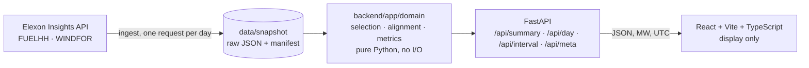

# ForeCheck — wind forecast audit for day-ahead procurement

ForeCheck shows a GB electricity procurement team **which national wind forecast they actually had at their day-ahead decision time**, and **how far that forecast turned out to be from what was generated**, for the 31 decisions made in January 2026.

- **Live app:** `https://c542ed61.vercel.app/`
- **Video (unlisted, ≤ 10 min):** `Thttps://youtu.be/XKsvRREjzMU`
- **Data:** Elexon Insights API: [FUELHH](https://bmrs.elexon.co.uk/api-documentation/endpoint/datasets/FUELHH/stream) (actuals, `fuelType=WIND`) and [WINDFOR](https://bmrs.elexon.co.uk/api-documentation/endpoint/datasets/WINDFOR/stream) (forecast runs). No other data sources.

## The problem

A supplier buys power for tomorrow's 48 half-hours before the day-ahead gate closes. Wind reduces how much it must buy, so the team leans on a wind forecast. Two things matter:

1. **Which forecast counts.** Forecasts improve as delivery approaches, but only runs published **at or before the gate** were usable. Scoring a later run would make the forecast look better than it was (look-ahead bias).
2. **How wrong it was, and which way.** An over-forecast means buying too little; an under-forecast means buying too much. A low average can hide large hourly misses.

ForeCheck does **not** compute how much power to buy. That needs the utility's demand, contracts, own wind portfolio and prices, none of which are in these datasets.

## What's in the app

| View                                    | What it answers                                                                                                                                                                              |
| --------------------------------------- | -------------------------------------------------------------------------------------------------------------------------------------------------------------------------------------------- |
| **January review** (`/`)                | Month verdict; MAE, RMSE, bias (split into constant vs varying), P90, coverage; a calendar of the 31 decisions; an error heat map by day × hour; accuracy by gate; the largest misses        |
| **Decision replay** (`/day/2026-01-14`) | For one delivery day: the run used and how old it was at the gate, the forecast vs actual chart with the signed gap, runs published after the gate, error by hour, and an hour-by-hour table |
| **Hour audit** (any "Audit" button)     | Every run that forecast that hour, which one was used, why later runs were excluded, and the raw Elexon records                                                                              |
| **Method & limits** (`/method`)         | Rules, metric definitions, the data audit, and known limitations, with figures computed live from the snapshot                                                                               |

The gate (`09:20` EPEX hourly, `09:50` N2EX, `15:30` EPEX half-hourly) is a URL parameter (`?gate=0950`), so any view can be shared.

### January 2026 results (09:20 gate, 744 delivery hours)

| MAE      | RMSE     | Mean error (bias) | P90 \|error\| | Over-forecast hours |
| -------- | -------- | ----------------- | ------------- | ------------------- |
| 2,022 MW | 2,497 MW | +1,746 MW         | 4,154 MW      | 630 of 744          |

A constant over-forecast accounts for 49% of the squared error. Even values a run gives for hours that had **already started** when it was published sit about 1,548 MW above the metered actual. So part of the "error" is a gap between what WINDFOR forecasts and what FUELHH meters (curtailment or coverage are plausible causes), not only forecasting skill. Full figures: [`docs/data-audit.md`](docs/data-audit.md).

## Method in one screen

- **Decision cutoff:** delivery day D, decision on D−1 at the gate time (UK local, `Europe/London`; GMT in January).
- **Selection:** for each delivery hour, the latest WINDFOR run with `publishTime ≤ cutoff`. Nothing published later is used; a missing forecast stays missing.
- **Alignment:** WINDFOR is hourly and FUELHH is half-hourly. Each hourly forecast is scored against the half-hour actual starting at the same `startTime`. A sensitivity check against the mean of both half-hours moves MAE from 2,022 to 2,039 MW.
- **Error:** `forecast − actual`; positive = over-forecast.
- **Metrics:** MAE, RMSE, mean error, P90 of |error|, bias share (`bias² / RMSE²`), coverage. Period figures are computed from individual hours, never by averaging daily figures. MAPE is not used (it breaks near zero wind).
- **Data quality:** nothing is dropped silently. Every rejected or merged record is counted by reason.

Details: [`docs/methodology.md`](docs/methodology.md) · decisions and trade-offs: [`docs/decisions.md`](docs/decisions.md).

## Architecture



- **Domain logic** (`backend/app/domain/`) is pure Python with no network or disk access, which is why 66 tests run in under a second.
- **Snapshot, not live:** January 2026 is history. The ingest script freezes it in `data/snapshot/` with a manifest of every request, so results are reproducible and the demo can't break if Elexon is slow. The UI says "historical snapshot".
- **Frontend** never calculates a metric; it formats what the API returns.

## Repository layout

```text
backend/
  app/
    domain/          models, gates (UK→UTC), selection, metrics, evaluation, normalise
    elexon/          client.py (retries), ingest.py (pull January → data/snapshot)
    store.py         loads the snapshot once
    service.py       analyses shared by the API and the audit report
    schemas.py       API response models (the contract)
    main.py          FastAPI routes
    audit.py         generates docs/data-audit.md
  tests/             66 pytest tests (domain, API contract, client)
  Dockerfile
frontend/
  src/api            typed client mirroring schemas.py
  src/lib            formatting (MW, signs, UK time), URL state, fetch hook
  src/components     layout, month views, replay chart, hour audit drawer
  src/pages          Month, Day, Method
  src/styles         tokens.css (palette, type) + app.css
  Dockerfile, nginx.conf
api/index.py         Vercel entry point (imports the FastAPI app)
data/snapshot/       windfor.json, fuelhh_wind.json, manifest.json
docs/                methodology, decisions, data audit
scripts/smoke.mjs    end-to-end check against a running app
docker-compose.yml · vercel.json · requirements.txt (Vercel function)
```

## Run it

### Prerequisites

Python 3.12+, Node 22+, and optionally Docker. No API keys: Elexon's API is public.

### Locally without Docker

```bash
# API
cd backend
python -m venv .venv && source .venv/bin/activate      # Windows: .venv\Scripts\activate
pip install -r requirements-dev.txt
pytest -q                                               # 66 passed
uvicorn app.main:app --reload                           # http://localhost:8000/api/docs

# Frontend (second terminal)
cd frontend
npm ci
npm run dev                                             # http://localhost:5173 (proxies /api to :8000)
```

### With Docker

```bash
docker compose up --build                 # app http://localhost:8080 · API http://localhost:8000/api/docs
docker compose run --rm tests             # run the test suite in a container
```

### Smoke test (local or deployed)

```bash
node scripts/smoke.mjs http://localhost:8080
node scripts/smoke.mjs https://c542ed61.vercel.app/
```

### Refresh the data

```bash
cd backend
python -m app.elexon.ingest --out ../data/snapshot   # re-pull January from Elexon
python -m app.audit                                  # regenerate docs/data-audit.md
```

## Configuration

| Variable                    | Default                 | Purpose                                                                |
| --------------------------- | ----------------------- | ---------------------------------------------------------------------- |
| `FORECHECK_DATA_DIR`        | `data/snapshot`         | Snapshot folder the API loads                                          |
| `FORECHECK_CORS_ORIGINS`    | _(none)_                | Comma-separated origins, only if the frontend is on a different domain |
| `FORECHECK_STALE_RUN_HOURS` | `6`                     | Flag a run as old at the gate above this age                           |
| `VITE_API_BASE`             | _(empty = same origin)_ | Frontend build: API base URL if hosted separately                      |
| `VITE_API_PROXY`            | `http://localhost:8000` | Dev server proxy target                                                |

## Deploy (Vercel)

One Vercel project serves the static React build and the FastAPI app as a Python function (`api/index.py`), on one URL with no CORS.

1. Push this repo to a **public GitHub repository with an anonymous name** (e.g. `openssl rand -hex 4`).
2. On vercel.com: **Add New → Project → Import** the repo. Leave settings as they are: `vercel.json` sets the install, build and output commands, the Python function, and the routes.
3. After it deploys, run `node scripts/smoke.mjs https://c542ed61.vercel.app/` and open the site. Change the gate and confirm the numbers change.

**If the combined deploy misbehaves** (untested alternative): host the API separately, for example the Docker image from `backend/Dockerfile`, which already contains `data/snapshot`, with `FORECHECK_CORS_ORIGINS` set to the frontend URL. Then deploy `frontend/` as a Vite project with `VITE_API_BASE` pointing at that API. A Vercel project rooted at `backend/` alone would not include `data/snapshot` and would return 503.

## Testing

- `backend/tests/test_selection.py`: latest run at or before the cutoff; **a later run is excluded even when it is more accurate**; a run exactly at the cutoff counts; several runs per hour; no run → no forecast (never a later one); naive datetimes refused.
- `test_gates.py`: D−1 cutoff in UK time → UTC, including BST and 23/25-hour clock-change days.
- `test_metrics.py`: MAE/RMSE/ME/P90 against hand-computed values; sign convention; RMSE² = bias² + spread²; empty input → unknown, not perfect.
- `test_evaluation.py`: exact vs hour-mean alignment; missing data counted, never filled; **month metrics are interval-weighted, not the mean of daily metrics**; gates change the run used; lead-time and after-the-fact checks.
- `test_normalise.py`: duplicates, conflicting values, bad timestamps, non-numeric values, implausible MW, revisions.
- `test_api.py`: contract tests on a hand-made snapshot; `/summary` and `/day` agree; one JSON error shape; missing snapshot → 503.
- `scripts/smoke.mjs`: end-to-end against a running app.
- Accessibility: automated WCAG 2.2 AA audit (axe-core) on every view at 1440 px and 390 px, with 0 violations, plus a keyboard walkthrough.

**Not tested:** frontend components have no unit tests (covered by the smoke script, the axe audit and manual checks); whether `publishTime` equals real-world availability (see limitations).

## Known limitations

- **Not a procurement calculator** and no savings claims; GB national wind, not the client's portfolio.
- **Definition gap:** WINDFOR sits above FUELHH even in hindsight; the cause can't be determined from these datasets.
- **Publish-time documentation mismatch:** Elexon's docs list runs one hour later than the January `publishTime` values (July matches the docs). The 09:20 results are identical either way; the 09:50 and 15:30 impact is shown on the Method page.
- **EPEX gate times** come from a secondary source (Modo Energy); N2EX's 09:50 is from Nord Pool.
- **One month, one season**, as a historical snapshot.

## AI tools used

This project was built with **Claude (Anthropic), in Claude Cowork**, used as a pair-programmer and research assistant for:

- domain research (GB day-ahead auction gates, Elexon dataset definitions) and the discovery report;
- the data investigation and audit scripts;
- code for the backend, tests, frontend, Docker and Vercel configuration;
- wireframes, documentation and presentation scripts.
- editing the demo video (cuts, title cards, labels, audio levelling) and generating its captions.

All key product and method decisions (gate default, evaluation period, how to present the bias gap, publish-time handling, palette and typography) were made by the developer, and every reported figure is computed from the committed snapshot by code in this repository.
